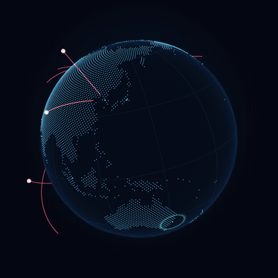

<p align="center">
  
</p>

<p align="center">
  <a href="https://lasmeldas.github.io/threat-globe-3d/"><b>Live demo</b></a> &nbsp;·&nbsp;
  <a href="#features">Features</a> &nbsp;·&nbsp;
  <a href="#how-it-works">How it works</a> &nbsp;·&nbsp;
  <a href="#run-it-locally">Run it</a> &nbsp;·&nbsp;
  <a href="#customize">Customize</a>
</p>

<p align="center">
  
  
  
  
  
</p>

<p align="center">Built by <a href="https://github.com/lasmeldas"><b>Beamlak</b></a></p>

<p align="center">
  <a href="https://lasmeldas.github.io/threat-globe-3d/">
    
  </a>
</p>

<p align="center"><b>Drag it, spin it, zoom in.</b> A living 3D Earth where simulated attacks fly between world cities and get blocked on arrival.</p>

> **All traffic is simulated.** The arcs are generated by a seeded animation for visual effect. No real attack, IP address or telemetry is shown or collected.

## Features

- **Real 3D, in your browser.** A dot-matrix Earth, a rim-lit sphere, an atmosphere glow and a starfield, all drawn with WebGL.
- **Live attack streams.** Sixteen simultaneous arcs follow great-circle paths between 16 world cities, with glowing heads and green impact rings.
- **Live HUD.** A running counter of blocked events, streams in flight, and a rolling feed of simulated events ("Mumbai → Nairobi · port scan").
- **Interactive.** Drag to rotate with inertia and tilt, scroll to zoom in and out.
- **Accessible.** A **Motion** button pauses the animation, `prefers-reduced-motion` starts it paused, controls have visible focus, and the page works without WebGL (it shows a message instead of breaking).
- **Light.** About 10 KB of map data, no framework, no bundler, one CDN import.

## How it works

- **The map is generated, not downloaded.** `src/land.js` holds a 1-degree land/ocean bitmask (about 10 KB) built from Natural Earth data. At startup, 30,000 evenly spaced points (a Fibonacci sphere) are tested against the mask, and only the land points are kept. That gives the even dot-matrix look with no image textures.
- **Arcs are great-circle curves.** Each stream spherically interpolates between two cities, lifts the path into an arc, and draws it as a tube. The tube's draw range is animated so a bright head runs ahead of a trailing tail.
- **Animation is a pure function of time.** Every arc's position comes from `t`, with a seeded random generator picking its cities. There's no hidden state, which means the same moment always draws the same frame. That is how the looping preview above is rendered frame by frame, and why it loops seamlessly.
- **Light effects are tiny shaders.** The atmosphere and the sphere's rim glow are short fragment shaders based on the surface angle to the camera.

## Run it locally

ES modules need a web server, so opening `index.html` directly won't work. From the project folder:

```bash
python3 -m http.server 8000
```

Then open http://localhost:8000. Add `?hud=0` to hide the interface and see only the globe.

## Customize

| What | Where |
|------|-------|
| Cities that traffic flows between | the `CITIES` list at the top of `src/main.js` |
| Number of simultaneous streams | `SLOTS` |
| How fast the globe spins | `SPIN_PERIOD` (seconds per turn) |
| Attack names in the feed | the `ATTACKS` list |
| Colors | the CSS variables in `style.css`, and the hex colors in `src/main.js` |
| Land map resolution | regenerate `src/land.js` from any equirectangular land mask |

## Deploy to GitHub Pages

Open **Settings → Pages**, choose **Deploy from a branch**, then `main` and `/ (root)`. The site appears at `https://<your-username>.github.io/threat-globe-3d/` after a minute or two.

## Project structure

```
threat-globe-3d/
├── index.html    # page, HUD markup, meta tags, import map
├── style.css     # theme and layout
├── src/
│   ├── main.js   # scene, arcs, interaction, HUD
│   └── land.js   # compact land/ocean bitmask
├── docs/         # banner, preview image and animation
├── .nojekyll
├── LICENSE
└── README.md
```

## Credits

[Three.js](https://threejs.org/) for rendering. Land outlines from [Natural Earth](https://www.naturalearthdata.com/) (public domain), via the [world-atlas](https://github.com/topojson/world-atlas) package.

## License

[MIT](LICENSE)

---

<p align="center">Built by <a href="https://github.com/lasmeldas"><b>Beamlak</b></a> &middot; <a href="https://github.com/lasmeldas">github.com/lasmeldas</a></p>
